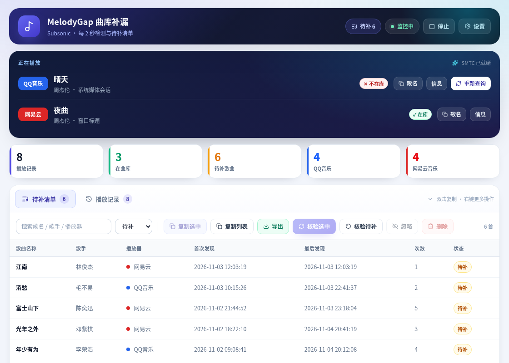

# MelodyGap

> 自动发现 QQ 音乐 / 网易云音乐中 Subsonic / Navidrome / Airsonic 曲库缺失的歌曲，整理成可核验、可导出的待补清单。

[](https://github.com/MaroD1M/melody-gap/actions/workflows/ci.yml)
[](https://github.com/MaroD1M/melody-gap/releases/latest)
[](LICENSE)
[](https://github.com/MaroD1M/melody-gap/releases/latest)
[](https://www.rust-lang.org/)
[](https://tauri.app/)

MelodyGap 是一个面向个人音乐曲库的 Windows 小工具：优先读取 Windows 系统媒体
会话（SMTC），不可用时回退 QQ 音乐 / 网易云音乐窗口标题，识别当前播放歌曲，
再通过 Subsonic API 查询你的 **Subsonic / Navidrome / Airsonic** 曲库。不在库里的
歌会自动进入本地待补清单，方便你之后统一补充。

当前版本为 **v2.0.1**。桌面端自 v2.0.0 起由 Python/Tkinter 重写为
**Rust + Tauri 2 + Svelte 5**，便携版体积更小、启动更快，也不再依赖 PyInstaller
自解压。v2.0.1 已通过 Windows 实机启动验证，并修复了发布版误连接开发服务器的问题。

它不获取音源、不操作播放器界面，也不会自动修改曲库。

## 界面预览

以下截图为示例数据，不是真实服务器或播放器状态。

| 待补清单 | 播放记录 |
| --- | --- |
|  |  |

| 右键菜单 | 设置窗口 |
| --- | --- |
|  |  |

| 通知窗口 |
| --- |
|  |

应用与托盘图标：

## 功能

- **自动检测**：约每 2 秒读取系统媒体会话（SMTC）；不可用时回退窗口标题，支持关闭主窗口、退到托盘和隐藏窗口，不注入进程。
- **双播放器并行**：QQ 音乐与网易云音乐同时播放时分别识别、并列展示，互不覆盖。
- **三态曲库查询**：在库 / 不在库 / 未知；未配置或查询失败不会污染待补清单。
- **待补清单**：跨播放器去重，记录首次/最后发现时间与播放次数，持久化到本地；支持搜索、排序、多选、忽略、恢复、删除。
- **人工核验**：补歌后核验选中或全部待补歌曲，已入库项自动移出清单并显示汇总。
- **复制与导出**：复制歌名、歌曲信息、选中项或当前筛选列表；导出 CSV 或 TXT；支持 `Ctrl+A` 全选、`Ctrl+C` 复制。
- **播放记录**：按在库/不在库/未知筛选，支持关键词搜索、按当前筛选导出 CSV 与清空。
- **提醒策略**：仅新缺失 / 所有缺失 / 全部歌曲 / 关闭，可设置同曲冷却时间。
- **现代桌面界面**：深色品牌栏、当前播放 Hero 卡、可点击统计卡、双页签布局、右键菜单与通知窗。
- **系统托盘**：托盘可用时可最小化、查看待补数量、开始/停止监控；不可用时自动降级为纯窗口模式。
- **Windows 缩放适配**：WebView2 跟随系统缩放比例渲染。
- **便携数据**：配置、日志、待补清单和 WebView2 数据全部写在 EXE 同目录。

## 工作方式

```text
QQ 音乐 / 网易云音乐
        │
        ├── Windows 系统媒体会话（SMTC，优先）
        └── 窗口标题（回退；可见窗口优先，其次隐藏窗口）
        │
        ▼
歌名 / 歌手 / 播放器（两个播放器分别维护）
        │
        ▼
Subsonic search3（旧服务器回退 search2）+ 歌名/歌手加权匹配
        │
        ├── 在库 ────────────────► 播放记录 + 自动移出待补清单
        ├── 不在库 ──────────────► 待补清单 + 可选通知
        └── 未知/查询失败 ───────► 仅记录，不提醒、不进待补
```

匹配会忽略常见版本后缀、标点、大小写与全半角差异。未配置服务器、网络超时、
认证失败等情况统一视为“未知”；当前歌曲查询失败后会自动重试，也可在界面手动重查。

## 下载与安装

### 方式一：下载构建好的 Windows 程序

前往 [GitHub Releases](https://github.com/MaroD1M/melody-gap/releases/latest) 下载：

- `MelodyGap-portable-windows-x64.zip`：**推荐**。便携目录版，解压后运行
  `MelodyGap\MelodyGap.exe`；
- `MelodyGap.exe`：Windows 可执行文件，适合直接替换已有便携目录中的旧版本；
- `SHA256SUMS.txt`：EXE 与 ZIP 的校验值；
- GitHub 同时提供源码 zip / tar 包。

把程序放到**可写目录**（不要放 `Program Files`），双击运行即可。首次运行会在
EXE 同目录生成 `config.ini`、`missing_songs.json`、`melodygap.log` 和
`webview2-data/`。

> Windows 10 1809 / 11。界面依赖 Microsoft Edge WebView2 Runtime（Windows 11
> 通常已内置；Windows 10 若无法打开窗口，请先安装 WebView2 Runtime）。
> 后台播放检测依赖 Windows SMTC，窗口回退依赖 Win32 API；其他系统无法自动检测播放器。

> **被安全软件拦截？** 未签名 EXE 可能被误报。请先核对 `SHA256SUMS.txt`
> 和文件属性中的版本信息，再参考 [误报处理与文件核验](docs/FALSE_POSITIVES.md)。
> 不要为了运行程序而关闭杀毒软件。

### 方式二：从源码运行

开发环境需要：

- Windows 10/11；
- Rust stable（MSVC toolchain）；
- Node.js 24+ 与 pnpm 12+；
- Microsoft Edge WebView2 Runtime。

```bash
git clone https://github.com/MaroD1M/melody-gap.git
cd melody-gap/rust
pnpm install --frozen-lockfile
pnpm desktop:dev
```

只调试前端界面时可以使用 `pnpm dev`，此时 Tauri 命令由 mock/浏览器环境处理，
不能验证播放器检测、托盘与通知。

## 配置

首次运行后点击主界面右下角“设置”，填写 Subsonic / Navidrome 连接信息：

| 字段 | 说明 |
| --- | --- |
| 服务器地址 | 例如 `https://music.example.com:4533/`，必须包含 `http://` 或 `https://` |
| 用户名 | Subsonic / Navidrome 登录用户名 |
| 密码 | 对应登录密码；已保存时留空表示保持不变 |
| 验证 HTTPS 证书 | 默认开启；仅自签名服务器可关闭 |
| 提醒模式 | 仅新缺失 / 所有缺失 / 全部歌曲 / 关闭 |
| 提醒冷却 | 同一首歌再次提醒的间隔，0～1440 分钟 |

也可以复制 `config.ini.example` 为 `config.ini` 手动编辑：

```ini
[SUBSONIC]
server_url = https://your-server.com:port/
username = your_username
password = your_password
verify_ssl = 1

[APP]
reminder_mode = new_missing
reminder_cooldown_minutes = 10
window_geometry = 1080x760
window_zoomed = 0
last_tab = 0
```

> `config.ini` 中的密码当前以明文保存在本地。请勿提交到公开仓库；项目的
> `.gitignore` 已默认忽略该文件。更安全的凭据存储方案见
> [SECURITY.md](SECURITY.md)。

## 使用流程

1. 启动 MelodyGap，确认托盘图标出现；
2. 打开 QQ 音乐或网易云音乐播放歌曲；
3. 程序自动查询曲库，并在“播放记录”中留下三态结果；
4. 不在库的歌曲进入“待补清单”；
5. 到合法渠道补齐歌曲并放入 Subsonic / Navidrome；
6. 回到程序选中歌曲，点击“核验选中”或“核验待补”，已入库的歌曲会自动移出清单。

“待补清单”和“播放记录”均支持右键菜单：可只复制歌名或“歌名 - 歌手”，也可
直接打开 QQ 音乐 / 网易云网页搜索。待补清单支持 `Ctrl` / `Shift` 多选与
`Ctrl+A` 全选、`Ctrl+C` 复制选中项；多选时右键菜单会显示数量。通知窗单击可
复制歌曲信息；待补清单中双击单行复制歌曲信息。

“核验”只重新查询曲库，不会下载或修改任何文件。

## 隐私与安全

- 所有配置、日志、待补清单与 WebView2 数据均保存在本地程序目录；
- 程序只访问你填写的 Subsonic / Navidrome 服务器；
- 不收集遥测，不上传歌名、账号或密码；
- 日志不会记录密码或认证 token；
- 程序只读取系统媒体会话元数据和播放器窗口标题，不注入进程、不模拟点击、不修改播放器收藏；
- 本项目**不提供**歌曲下载、音源抓取、绕过平台限制或自动入库功能。

请遵守所在地区法律及音乐平台服务条款，仅将本工具用于管理自己合法拥有的音乐库。

## 状态与限制

- 三态：`True` 在库、`False` 不在库、`None` 未知；未知不提醒、不进入待补清单。
- SMTC 需要 Windows 10 1809+ 且播放器主动注册媒体会话；QQ 音乐新版已支持，网易云及旧版本需按实际版本验收。
- 没有 SMTC 时回退窗口标题；若播放器关闭到托盘后销毁了带歌名的窗口，标题回退无法保证检测。
- 两个播放器同时播放时，当前歌曲与播放记录按播放器分别维护；待补清单仍按“歌名 + 歌手”跨播放器去重。
- SMTC 可读取播放/暂停状态；窗口回退只能看到最后标题，无法可靠区分暂停与继续播放。
- 匹配基于歌名与歌手的模糊相似度；极端命名或服务器元数据缺失时可能误判。
- 播放历史目前仅保存在本次运行内存中，退出程序后清空；待补清单会持久化。
- 配置密码为明文保存；发布版本未签名。
- 本项目与腾讯、网易、Subsonic、Navidrome、Airsonic 均无关联。

## 项目结构

```text
melody-gap/
├── rust/
│   ├── crates/melodygap-core/   # 匹配、Subsonic、监控、配置、待补仓库
│   ├── src-tauri/               # Tauri 后端、SMTC/Win32 检测、托盘、通知
│   ├── src/                     # Svelte 5 + TypeScript 前端
│   ├── dist/                    # 前端构建产物（构建时生成）
│   └── release/                 # 本地 Windows 便携包（构建时生成）
├── docs/                        # 开发文档、误报说明、界面预览
├── app/                         # 旧 Python 实现，保留作行为参考
└── .github/workflows/           # Rust CI 与 Release 构建
```

`app/` 与 `main.py` 是 v1.x 的 Python 实现，保留用于对照历史行为；Release 和 CI
只构建 `rust/`。

## 从源码构建

在 Windows（MSVC toolchain）上：

```powershell
cd rust
pnpm install --frozen-lockfile
pnpm check
pnpm build
cargo test --workspace
cargo build --release --target x86_64-pc-windows-msvc -p melodygap --features custom-protocol
```

产物：

```text
rust/target/x86_64-pc-windows-msvc/release/melodygap.exe
```

使用 GNU target 交叉编译时，还需要把同目录的 `WebView2Loader.dll` 一起分发；
MSVC 构建会静态链接 WebView2 Loader，不需要该 DLL，但仍需要系统 WebView2 Runtime。

便携包至少包含：

```text
MelodyGap/
├── MelodyGap.exe
├── config.ini.example
└── LICENSE
```

GitHub Actions 的 Release 工作流会自动完成编译、打包、SHA256 与冒烟测试，见
[`.github/workflows/release.yml`](.github/workflows/release.yml)。

本地验证打包结果：

```powershell
.\MelodyGap\MelodyGap.exe --smoke-test
```

退出码为 0 表示可执行文件能加载并创建便携数据目录。

## 自动测试与发布

```bash
cd rust
cargo fmt --all -- --check
cargo clippy --workspace --all-targets -- -D warnings
cargo test --workspace       # 122 项
pnpm check
pnpm build
```

- `.github/workflows/ci.yml`：Windows Runner 上安装 Rust/Node/pnpm，运行格式、
  clippy、Rust 测试、前端检查与构建，然后构建并冒烟测试便携包；
- `.github/workflows/release.yml`：推送 `v*` 标签后重复上述检查，生成
  `MelodyGap-portable-windows-x64.zip` 与 `SHA256SUMS.txt`，并创建 GitHub Release；
- 版本号同时维护在 `rust/Cargo.toml`、`rust/src-tauri/tauri.conf.json`、
  `rust/package.json` 与 `rust/crates/melodygap-core/src/constants.rs`。

发布新版本：

```bash
# 1. 更新版本号与 CHANGELOG
# 2. 提交并推送 main
VERSION=2.0.2
git tag "v$VERSION"
git push origin main
git push origin "v$VERSION"
```

## 开发文档

- [DEVELOPMENT.md](docs/DEVELOPMENT.md)：Rust/Tauri 架构、检测链路、测试与打包细节；
- [PROJECT_STATUS.md](docs/PROJECT_STATUS.md)：当前状态、已知限制与后续路线；
- [FALSE_POSITIVES.md](docs/FALSE_POSITIVES.md)：误报原因、SHA256/版本核验与申诉模板；
- [CHANGELOG.md](CHANGELOG.md)：版本变更历史；
- [CONTRIBUTING.md](CONTRIBUTING.md)：开发环境、代码约定与 PR 要求；
- [SECURITY.md](SECURITY.md)：凭据、漏洞报告与安全边界。

## 常见问题

**Q1：托盘不显示？**
查看 `melodygap.log` 是否出现托盘初始化失败。程序会降级为纯窗口模式，此时关闭
窗口即退出。

**Q2：所有歌都显示“不在库”？**
先检查设置中的服务器地址是否仍为占位地址；再确认服务器可访问、账号密码正确、
服务器支持 `search3`（或可回退 `search2`）。

**Q3：明明在曲库却判为不在？**
查看日志中的候选列表与分数。常见原因：标题解析反了（歌手/歌名互换）、服务器
返回的歌手字段为空、相似度略低于阈值。

**Q4：播放时没有反应？**
优先看日志中的 SMTC 状态；若降级到窗口标题，确认播放器进程名在支持列表内、
窗口标题包含分隔符，并检查是否有“标题解析失败”。

**Q5：为什么暂停后“当前播放”还在？**
窗口标题回退无法区分暂停/播放。新版播放器且 SMTC 可用时可读取播放状态，但当前
历史记录仍按“当前歌曲”处理，不单独记录暂停事件。

**Q6：日志在哪里？**
在 EXE 同目录的 `melodygap.log`。日志按 1 MB 轮转，保留 3 份备份。

## License

[MIT](LICENSE)
