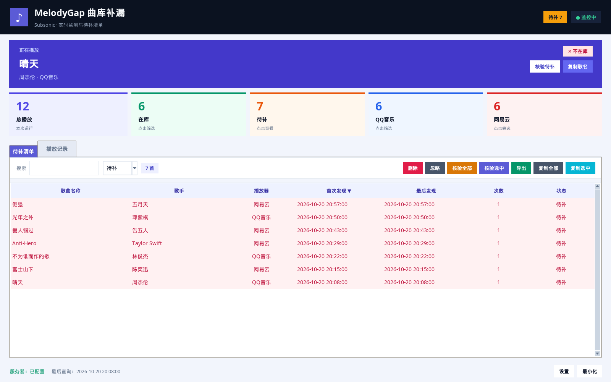
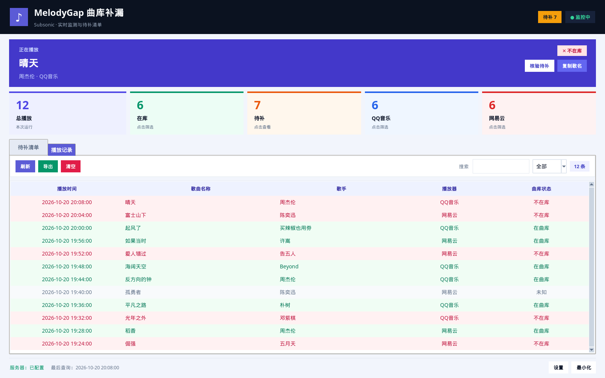
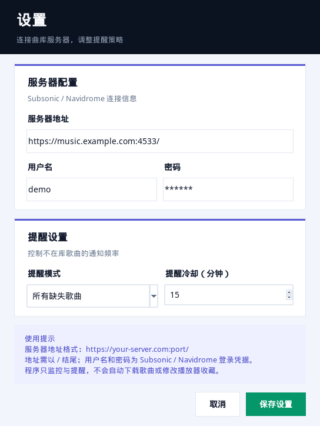

# MelodyGap

> **Know what your music library is missing.**
> 实时发现 QQ 音乐 / 网易云音乐里“曲库里还没有”的歌，整理成可核验、可导出的待补清单。

[](https://github.com/MaroD1M/melody-gap/actions/workflows/ci.yml)
[](https://github.com/MaroD1M/melody-gap/releases/latest)
[](LICENSE)
[](https://github.com/MaroD1M/melody-gap/releases/latest)
[](https://www.python.org/)

MelodyGap 是一个面向个人音乐曲库的 Windows 小工具：它读取 QQ 音乐 / 网易云音乐的
窗口标题，识别当前播放歌曲，再通过 Subsonic API 查询你的 **Subsonic / Navidrome /
Airsonic** 曲库。不在库里的歌会自动进入本地待补清单，方便你之后统一补充。

它不下载歌曲、不操作播放器界面、不处理 DRM，也不会自动修改曲库。

## 界面预览

以下截图为示例数据，不是真实服务器或播放器状态。

| 待补清单 | 播放记录 |
| --- | --- |
|  |  |



## 功能

- **实时检测**：通过窗口标题识别 QQ 音乐 / 网易云音乐当前播放歌曲，不注入进程。
- **三态曲库查询**：在库 / 不在库 / 未知；未配置或查询失败不会污染待补清单。
- **待补清单**：跨播放器去重，记录首次/最后发现时间与播放次数，持久化到本地。
- **人工核验**：补歌后核验选中或全部歌曲，已入库项自动移出清单并显示汇总。
- **搜索与导出**：按待补/已忽略/全部筛选，复制选中/全部，导出 CSV 或 TXT。
- **播放记录**：按在库/不在库/未知筛选，支持关键词搜索、CSV 导出与清空。
- **提醒策略**：仅新缺失 / 所有缺失 / 全部歌曲 / 关闭，可设置同曲冷却时间。
- **现代桌面界面**：深色品牌栏、当前播放 Hero 卡、彩色统计卡、双页签布局。
- **系统托盘**：最小化到托盘、待补数量入口、开始/停止监控、窗口状态记忆。
- **高 DPI 适配**：Windows 高缩放屏幕下保持清晰。

## 工作方式

```text
QQ 音乐 / 网易云音乐窗口标题
        │
        ▼
标题解析：歌名 / 歌手 / 播放器
        │
        ▼
Subsonic search3 + 歌名/歌手加权匹配
        │
        ├── 在库 ────────────────► 播放记录 + 自动移出待补清单
        ├── 不在库 ──────────────► 待补清单 + 可选通知
        └── 未知/查询失败 ───────► 仅记录，不提醒、不进待补
```

匹配会忽略常见版本后缀、标点、大小写与全半角差异。未配置服务器、网络超时、
认证失败等情况统一视为“未知”。

## 下载与安装

### 方式一：下载构建好的 EXE

前往 [GitHub Releases](https://github.com/MaroD1M/melody-gap/releases/latest) 下载：

- `MelodyGap.exe`：Windows 单文件程序，无需安装 Python；
- `MelodyGap-windows-x64.zip`：EXE + 配置示例 + 说明文件；
- `MelodyGap.exe.sha256`：校验文件；
- GitHub 同时提供源码 zip / tar 包。

把程序放到**可写目录**（不要放 `Program Files`），双击运行即可。首次运行会在
EXE 同目录生成 `config.ini`、`missing_songs.json` 和日志文件。

> Windows 10 / 11。播放器检测依赖 Win32 窗口 API，其他系统只能运行核心逻辑，
> 无法自动检测播放器。

### 方式二：从源码运行

```bash
git clone https://github.com/MaroD1M/melody-gap.git
cd melody-gap
python -m venv .venv
# Windows:
.venv\Scripts\activate
pip install -r requirements.txt
python main.py
```

要求 Python 3.8+。

## 配置

首次运行后点击主界面右下角“设置”，填写 Subsonic / Navidrome 连接信息：

| 字段 | 说明 |
| --- | --- |
| 服务器地址 | 例如 `https://music.example.com:4533/`，必须包含 `http://` 或 `https://` |
| 用户名 | Subsonic / Navidrome 登录用户名 |
| 密码 | 对应登录密码 |
| 提醒模式 | 仅新缺失 / 所有缺失 / 全部歌曲 / 关闭 |
| 提醒冷却 | 同一首歌再次提醒的间隔，0～1440 分钟 |

也可以复制 `config.ini.example` 为 `config.ini` 手动编辑：

```ini
[SUBSONIC]
server_url = https://your-server.com:port/
username = your_username
password = your_password

[APP]
reminder_mode = new_missing
reminder_cooldown_minutes = 10
window_geometry = 1080x760
window_zoomed = 0
last_tab = 0
```

> `config.ini` 中的密码当前以明文保存在本地。请勿提交到公开仓库；项目的
> `.gitignore` 已默认忽略该文件。更安全的凭据存储方案见
> [SECURITY.md](SECURITY.md)。

## 使用流程

1. 启动 MelodyGap，确认托盘图标出现；
2. 打开 QQ 音乐或网易云音乐播放歌曲；
3. 程序自动查询曲库，并在“播放记录”中留下三态结果；
4. 不在库的歌曲进入“待补清单”；
5. 到合法渠道补齐歌曲并放入 Subsonic / Navidrome；
6. 回到程序点击“核验选中”或“核验全部”，已入库的歌曲会自动移出清单。

“待补清单”中右键歌曲可直接打开 QQ 音乐 / 网易云网页搜索；“核验”只重新查询
曲库，不会下载或修改任何文件。

## 隐私与安全

- 所有配置、日志和待补清单均保存在本地程序目录；
- 程序只访问你填写的 Subsonic / Navidrome 服务器；
- 不收集遥测，不上传歌名、账号或密码；
- 日志不会记录密码或认证 token；
- 程序只读取播放器窗口标题，不注入进程、不模拟点击、不修改播放器收藏；
- 本项目**不提供**歌曲下载、DRM 解密、破解或自动入库功能。

请遵守所在地区法律及音乐平台服务条款，仅将本工具用于管理自己合法拥有的音乐库。

## 状态与限制

- 三态：`True` 在库、`False` 不在库、`None` 未知；未知不提醒、不进入待补清单。
- 暂停播放时窗口标题可能不变，因此无法区分暂停和继续播放。
- 匹配基于歌名与歌手的模糊相似度；极端命名或服务器元数据缺失时可能误判。
- 需要 Subsonic 兼容服务器支持 `search3`。
- 通知窗、托盘和播放器检测均在 Windows 上使用；真实播放器兼容性需按实际版本验收。
- 本项目与腾讯、网易、Subsonic、Navidrome、Airsonic 均无关联。

## 从源码构建

```bat
pip install -r requirements-dev.txt

pyinstaller --onefile --windowed ^
  --name MelodyGap ^
  --icon icon.ico ^
  --add-data "icon.ico;." ^
  main.py
```

产物位于 `dist/MelodyGap.exe`。配置、待补清单与日志写在 EXE 同目录。

## 自动测试与发布

- `.github/workflows/ci.yml`：每次 push / PR 运行 `ruff` 与 83 项单元测试；
- `.github/workflows/release.yml`：推送 `v*` 标签后，在 Windows Runner 上运行测试、
  构建单文件 EXE、生成 ZIP 与 SHA256，并自动创建 GitHub Release；
- GitHub 会自动附带源码包，用户可直接下载源码或自动构建的 EXE。

发布新版本：

```bash
# 更新 APP_VERSION 与 CHANGELOG.md 后
git tag v2.2.0
git push origin v2.2.0
```

## 开发

```bash
pip install -r requirements-dev.txt
python -m unittest discover -s tests -v
ruff check .
```

测试覆盖标题解析、匹配算法、Subsonic 客户端、配置、数据模型、待补清单、
提醒策略与监控缓存，全部为离线测试。更多架构、线程模型与扩展说明见
[docs/DEVELOPMENT.md](docs/DEVELOPMENT.md)，历史版本见 [CHANGELOG.md](CHANGELOG.md)。

## 项目结构

```text
melody-gap/
├── main.py                     # 入口：日志、单实例锁、启动 TrayApp
├── config.ini.example          # 配置示例
├── requirements*.txt
├── icon.ico
├── app/
│   ├── constants.py            # 全局常量
│   ├── models.py               # SongInfo / PlayRecord / MissingSong
│   ├── config_manager.py       # config.ini 读写
│   ├── logging_setup.py        # 滚动日志
│   ├── services/               # 标题解析、匹配、Subsonic、监控、待补仓库
│   ├── ui/                     # 主窗口、设置、通知、托盘、主题
│   └── utils/                  # 单实例锁
├── docs/
│   ├── DEVELOPMENT.md          # 开发与维护手册
│   └── previews/               # 界面预览图
├── tests/                      # 标准库 unittest
└── .github/                    # CI、Release 与 Issue 模板
```

## 常见问题

**托盘图标不显示？**  
查看日志中是否出现 pystray 加载失败。程序会降级为纯窗口模式，此时关闭窗口会退出。

**所有歌都显示“不在库”？**  
确认服务器地址、用户名、密码正确，服务器可访问且支持 `search3`。

**明明在曲库却判为不在？**  
查看日志中的候选与分数，常见原因是歌名/歌手顺序或服务器元数据不一致。

**日志在哪里？**  
源码运行在项目根目录，EXE 运行在 EXE 同目录，文件名为 `melodygap.log`。

## 贡献

欢迎提交 Bug、功能建议或 Pull Request。请先阅读
[CONTRIBUTING.md](CONTRIBUTING.md)。安全问题请按 [SECURITY.md](SECURITY.md)
私下报告，不要公开披露凭据或服务器地址。

## License

[MIT](LICENSE) © 2026 MaroD1M
